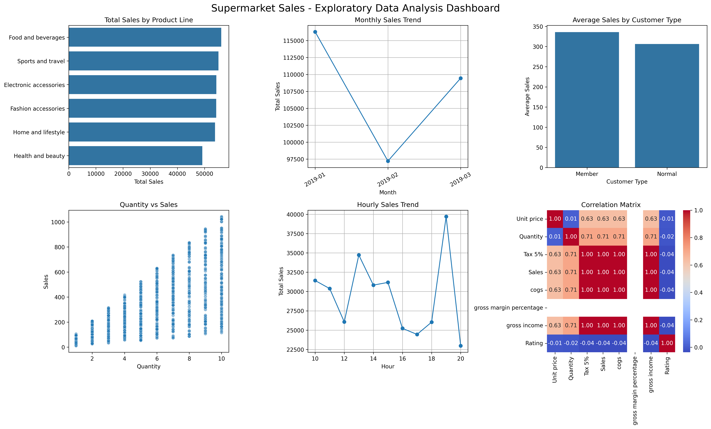

# Thiranex Virtual Internship – Task 3

## Exploratory Data Analysis (EDA) Project

### Objective

The objective of this task is to analyze the Supermarket Sales dataset using statistical summaries and visualizations to identify patterns, trends, correlations, and factors associated with sales.

---

## Dataset

The dataset contains **1000 supermarket transactions** with **17 original columns**.

### Data Quality

- Rows: 1000
- Columns: 17
- Missing values: 0
- Duplicate rows: 0

The analysis was performed using the original dataset.

---

## Statistical Summary

Key numerical statistics:

| Variable | Mean | Minimum | Maximum |
|---|---:|---:|---:|
| Unit price | 55.67 | 10.08 | 99.96 |
| Quantity | 5.51 | 1 | 10 |
| Tax 5% | 15.38 | 0.51 | 49.65 |
| Sales | 322.97 | 10.68 | 1042.65 |
| cogs | 307.59 | 10.17 | 993.00 |
| Gross income | 15.38 | 0.51 | 49.65 |
| Rating | 6.97 | 4.0 | 10.0 |

---

## Categorical Analysis

### Customer Type

- Member: 565 transactions
- Normal: 435 transactions

### Gender

- Female: 571 transactions
- Male: 429 transactions

### Product Line

- Fashion accessories: 178
- Food and beverages: 174
- Electronic accessories: 170
- Sports and travel: 166
- Home and lifestyle: 160
- Health and beauty: 152

### Payment Method

- Ewallet: 345
- Cash: 344
- Credit card: 311

---

## Correlation Analysis

Important correlations identified from the numerical variables:

| Variable Pair | Correlation |
|---|---:|
| Quantity – Sales | 0.71 |
| Unit price – Sales | 0.63 |
| Sales – Tax 5% | 1.00 |
| Sales – cogs | 1.00 |
| Sales – Gross income | 1.00 |
| Rating – Sales | -0.04 |

The positive correlation between Quantity and Sales indicates that higher quantities are generally associated with higher sales values in this dataset.

The correlations of 1.00 between Sales and Tax, cogs, and Gross income occur because these variables are mathematically derived from the transaction values.

The Rating–Sales correlation is close to zero, indicating very little linear association between the two variables.

---

## Sales Analysis

### Product Line

- **Highest total sales:** Food and beverages
- **Lowest total sales:** Health and beauty
- **Highest average sales:** Home and lifestyle

### Branch

Giza had the highest average sales among the three branches.

### Customer Type

Members had a higher average sales value than Normal customers.

### Gender

Female customers had a higher average sales value than male customers.

### Payment Method

Cash transactions had the highest average sales value among the payment methods.

---

## Time-Based Analysis

### Monthly Sales

| Month | Total Sales |
|---|---:|
| January 2019 | 116291.87 |
| February 2019 | 97219.37 |
| March 2019 | 109455.51 |

January 2019 recorded the highest total sales, followed by a decrease in February and a recovery in March.

### Hourly Sales

The highest total sales were observed at **19:00 (7 PM)**, with approximately **39,699.51** in sales.

---

## Outlier Analysis

IQR-based outlier detection was performed on the numerical variables.

| Variable | Outliers |
|---|---:|
| Unit price | 0 |
| Quantity | 0 |
| Tax 5% | 9 |
| Sales | 9 |
| cogs | 9 |
| Gross income | 9 |
| Rating | 0 |

The identified high-value observations were retained because they represent valid transactions rather than confirmed data-entry errors.

---

## Key Insights

1. Food and beverages generated the highest total sales among the product lines.
2. Home and lifestyle had the highest average sales per transaction.
3. Quantity showed a positive correlation with Sales (0.71).
4. Unit price showed a positive correlation with Sales (0.63).
5. January recorded the highest monthly sales.
6. 7 PM recorded the highest total sales among the observed transaction hours.
7. Sales had very little linear correlation with customer Rating.
8. The dataset contained no missing values or duplicate rows.

These findings describe associations observed in the dataset and do not establish causal relationships.

---

## EDA Dashboard

The final dashboard contains:

- Total Sales by Product Line
- Monthly Sales Trend
- Average Sales by Customer Type
- Quantity vs Sales
- Hourly Sales Trend
- Correlation Matrix

---

## Project Files

### Jupyter Notebook

[Thiranex Task 3 – Exploratory Data Analysis](Thiranex_Task_3_Exploratory_Data_Analysis.ipynb)

### EDA Dashboard

[Supermarket EDA Dashboard](supermarket_eda_dashboard.png)

---

## Technologies Used

- Python
- Google Colab
- Pandas
- NumPy
- Matplotlib
- Seaborn
- GitHub

---

## Internship Task

**Thiranex Virtual Internship – Task 3: Exploratory Data Analysis (EDA) Project**
